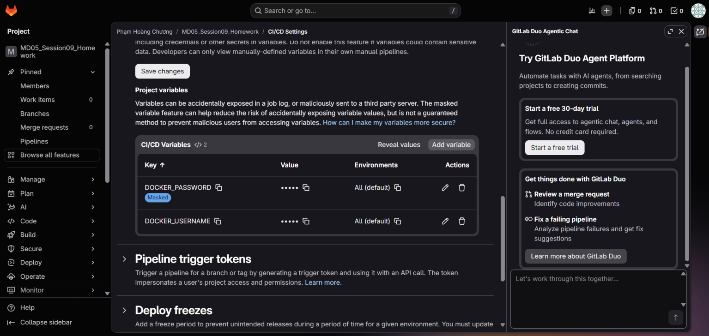

# Bài tập 4: Đẩy Docker Image lên Docker Hub thông qua GitLab CI

## 1. File `.gitlab-ci.yml`

👉 [`.gitlab-ci.yml`](../.gitlab-ci.yml) (file phải nằm ở thư mục gốc repo để GitLab nhận diện)

Pipeline gồm 3 stage chạy tuần tự: `test` → `build` → `dockerize`.

Job `docker_job` (stage `dockerize`):

```yaml
docker_job:
  stage: dockerize
  image: docker:latest
  services:
    - docker:dind
  variables:
    DOCKER_TLS_CERTDIR: "/certs"
    IMAGE_NAME: "$DOCKER_USERNAME/payment-service"
  dependencies:
    - build_job            # tải file .jar từ artifacts của build_job
  before_script:
    - ls -l build/libs     # kiểm tra file jar đã có
    - echo "$DOCKER_PASSWORD" | docker login -u "$DOCKER_USERNAME" --password-stdin
  script:
    - docker build -t $IMAGE_NAME:$CI_COMMIT_SHORT_SHA -t $IMAGE_NAME:latest .
    - docker push $IMAGE_NAME:$CI_COMMIT_SHORT_SHA
    - docker push $IMAGE_NAME:latest
  after_script:
    - docker logout
```

- Dùng Docker-in-Docker (`docker:dind`) để build image ngay trong pipeline.
- Thông tin đăng nhập lấy từ biến bảo mật `$DOCKER_USERNAME` và `$DOCKER_PASSWORD`, **không hard-code** trong file.
- `dependencies: build_job` lấy file `build/libs/payment-service-1.0.0.jar` từ artifacts của stage build, rồi [`Dockerfile`](../Dockerfile) đóng gói file này thành image.
- Mỗi lần chạy đẩy 2 tag: mã commit (`$CI_COMMIT_SHORT_SHA`) và `latest`.

## 2. Docker Hub Repository

👉 **https://hub.docker.com/r/chuongdocker2004/payment-service**

Image đã được pipeline push thành công, mỗi commit có một tag riêng (ví dụ `5762fc52`, `a67fb957`), kèm tag `latest` trỏ tới bản mới nhất.

```bash
docker pull chuongdocker2004/payment-service:latest
```

## 3. Cài đặt CI/CD Variables trên GitLab

**Settings → CI/CD → Variables**:

| Key | Value | Ghi chú |
|---|---|---|
| `DOCKER_USERNAME` | Username Docker Hub | |
| `DOCKER_PASSWORD` | Docker Hub Personal Access Token (quyền Read & Write) | **Masked**: bị che trong log |


